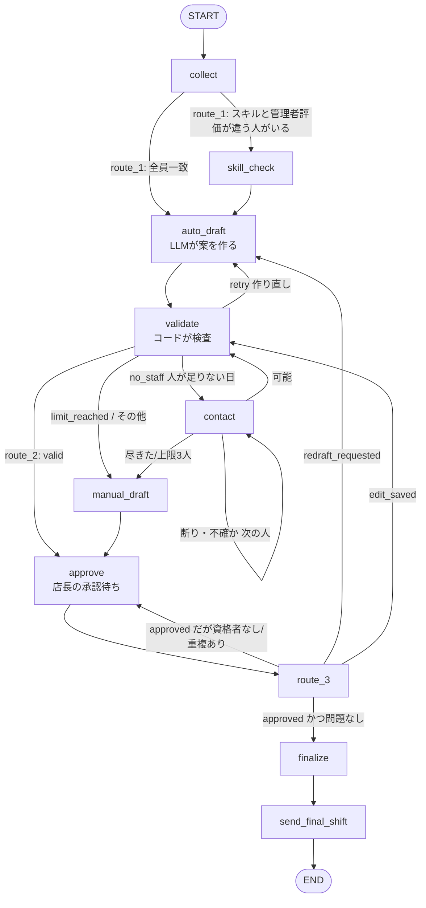

# CoverShift Backend (FastAPI)

# app/graph — シフト編成グラフ

[한국어](README.md) | [日本語](README.ja.md)

> **AIは提案だけ。最終確定は人(店長)。**
> 元の設計は `データフロー.md`。食い違ったら、そちらが正です。

LangGraph で作った、月間シフト編成のグラフです。
希望を集める → AI(LLM)が案を作る → **コードが**ルールを検査する → 店長が承認して確定する、という流れです。
(ルールを守れているかを決めるのは、LLM ではなく、コードです。)

## 1. ファイルの役割

| ファイル          | 役割                                                                                    |
| ----------------- | --------------------------------------------------------------------------------------- |
| `shift_graph.py`  | **実行の入口だけ**。`builder` を外に見せる。`python shift_graph.py start` で動かす      |
| `graph.py`        | **処理の中身**。ノード(collect〜send_final_shift)と、つなぎ(`builder`)                  |
| `routes.py`       | 分岐 `route_1`〜`route_3`(次にどこへ行くかだけを決める)                                 |
| `state.py`        | `State`(グラフ全体で共有する箱)                                                         |
| `settings.py`     | 定数・店舗ごとの設定・スタッフデータ。**B1/D5 でDB・MCPからの読み込みに置き換える場所** |
| `node/checks.py`  | ルールの検査と計算。**LLMを使わない、コードだけの検査**                                 |
| `node/llm.py`     | LLM の用意と、返事からのJSON取り出し                                                    |
| `node/prompts.py` | LLM に渡す文章(`rules` と `make_*_text`)                                                |

読み込みの向き(循環しないように一方通行): `settings` ← `state` / `node.checks` ← `routes` ← `graph` ← `shift_graph`

## 2. 処理番号と、ファイル・関数の対応

設計書・コメントにある番号(`2-1` など)から、コードの場所を探すための表です。**番号は、処理の流れの順**です。

| 番号 | 内容                                   | 種類      | ファイル             | 関数・もの                                      | 旧番号※        |
| ---- | -------------------------------------- | --------- | -------------------- | ----------------------------------------------- | -------------- |
| 0    | 初期設定                               | -         | `settings.py`        | 定数、`STORE_SETTINGS`、スタッフデータ          | 0              |
| 1    | State の箱                             | -         | `state.py`           | `State`                                         | 1              |
| 2-1  | 希望・スキル・指示を読む               | コード    | `graph.py`           | `collect`                                       | 2-1            |
| 2-2  | スキルチェックが必要か                 | **分岐①** | `routes.py`          | `route_1`                                       | 2-2            |
| 2-3  | 未確認を店長に知らせる(止まらない)     | コード    | `graph.py`           | `skill_check`                                   | 2-3            |
| 2-4  | AIが編成案を作る                       | LLM       | `graph.py`           | `auto_draft`                                    | 2-5            |
| 2-5  | 各ルールの検査                         | コード    | `graph.py`           | `validate`                                      | 2-6            |
| 2-6  | 検査の結果で、次の行き先を決める       | **分岐②** | `routes.py`          | `route_2`                                       | 2-6c           |
| 2-7  | 管理者の手動編成                       | コード    | `graph.py`           | `manual_draft`                                  | 2-7            |
| 2-8  | 人が足りない日の連絡(LINE送信は未実装) | 待機      | `graph.py`           | `contact`                                       | 2-8            |
| 2-9  | 管理者の承認                           | 待機      | `graph.py`           | `approve`                                       | 2-9            |
| 2-10 | 店長の決定で、次の行き先を決める       | **分岐③** | `routes.py`          | `route_3`                                       | 2-10           |
| 2-11 | 確定を保存(仮実装)                     | コード    | `graph.py`           | `finalize`                                      | 2-11           |
| 2-12 | 各従業員に通知(仮実装)                 | コード    | `graph.py`           | `send_final_shift`                              | 2-13           |
| 3-1  | 検査と計算の道具                       | コード    | `node/checks.py`     | `check_*`、`to_min`、`build_contact_queue` など | 2-4, 2-6, 2-6b |
| 3-2  | LLMの用意・JSONの取り出し              | コード    | `node/llm.py`        | `get_llm`、`extract_json`                       | 2-4            |
| 3-3  | LLMに渡す文章                          | コード    | `node/prompts.py`    | `rules`、`make_*_text`                          | 2-5, 2-6a      |
| 4    | ノードの登録                           | -         | `graph.py`(下のほう) | `builder.add_node`                              | 3              |
| 5    | ノードの連結                           | -         | `graph.py`(下のほう) | `builder.add_edge` など                         | 4              |
| 6    | 実行                                   | -         | `shift_graph.py`     | `if __name__ == "__main__":`                    | 5              |

※ 旧番号は、前の版のコメントや、`データフロー.md` などの古い資料と見比べるための列です。旧「会社の規定に変換」(旧2-12)は、削除したので、番号がありません。

## 3. 流れ



## 4. 分岐は3つ

| 分岐               | どこの次   | 見る値                        | 行き先                                                                                                           |
| ------------------ | ---------- | ----------------------------- | ---------------------------------------------------------------------------------------------------------------- |
| **route_1** (2-2)  | `collect`  | `staff_skill` と `admin_rate` | 1人でも違う → `skill_check` / 全員一致 → `auto_draft`                                                            |
| **route_2** (2-6)  | `validate` | `result`                      | `valid` → `approve` / `no_staff` → `contact` / `retry` → `auto_draft` / `limit_reached`・その他 → `manual_draft` |
| **route_3** (2-10) | `approve`  | `decision`                    | 下の表                                                                                                           |

**route_3 の行き先**(店長の決定ごと):

| decision            | 条件                               | 行き先                                                                         |
| ------------------- | ---------------------------------- | ------------------------------------------------------------------------------ |
| `approved`          | 資格者なし・重複が**残っていない** | `finalize`                                                                     |
| `approved`          | 資格者なし・重複が**残っている**   | `approve` に戻る(理由を `blocked_reasons` に入れる)                            |
| `redraft_requested` | やり直しを頼んだ回数が2回未満      | `auto_draft`(店長のやり直し回数 +1。LLMの回数と、連絡した人数・候補をリセット) |
| `redraft_requested` | すでに2回頼んだ                    | `approve` に戻る(「2回までです」と理由を出す)                                  |
| `edit_saved`        | (店長が案を直して保存した)         | `validate`(LLMは呼ばない)                                                      |
| その他              | -                                  | `ValueError`                                                                   |

## 5. validate の判定(result の決まり方)

`validate` は、上から順に調べて、最初に当てはまったもので `result` が決まります。

| 順  | 条件                                                                        | result          | 次(route_2)                                           |
| --- | --------------------------------------------------------------------------- | --------------- | ----------------------------------------------------- |
| ⓪   | 検査回数が上限(`upper_limit`)を超えている                                   | `limit_reached` | `manual_draft`                                        |
| ①   | 案が空                                                                      | `retry`         | `auto_draft`                                          |
| ②   | 問題あり、かつ店長が直した案(`edit_saved`)                                  | `limit_reached` | `manual_draft`(LLMは呼ばない。店長の編集が消えるため) |
| ③   | 問題あり、かつ前回と同じ問題(人数の数字だけ違うものも同じ扱い)              | `limit_reached` | `manual_draft`(これ以上は直らない)                    |
| ④   | 問題あり、かつ作り直しの上限(`UPPER_LIMIT` = 3)に達した                     | `limit_reached` | `manual_draft`                                        |
| ⑤   | 問題あり                                                                    | `retry`         | `auto_draft`(問題の一覧を次のLLMに渡す)               |
| ⑥   | 問題なし                                                                    | `valid`         | `approve`                                             |
| ⑥′  | 問題なしだが、人が足りない日が残っていて、連絡できる人がいる(連絡は3人まで) | `no_staff`      | `contact`                                             |

**検査は7つ**(`node/checks.py`。どれも、問題の文章のリストを返す。空なら問題なし):

| 検査                   | 見ること                                                   | 承認を止める? |
| ---------------------- | ---------------------------------------------------------- | ------------- |
| `check_coverage`       | どの30分にも社員が1人以上いる(開店・閉店作業のため)        | -             |
| `check_qualification`  | 資格者が足りている                                         | **止める**    |
| `check_requests`       | パート・バイトが、申請のない日に入っていない               | -             |
| `check_closing`        | 22:30まで残るのは、`closing_ok` の人だけ                   | -             |
| `check_shain_days`     | 社員の出勤日数が決まりどおり                               | -             |
| `check_headcount`      | 時間帯ごとの最低人数(そもそも足りない日は、ここでは見ない) | -             |
| `check_double_booking` | 同じ人の勤務が、同じ日に重なっていない                     | **止める**    |

「承認を止める」検査は、管理者でも外せません。残っていると `approved` は通らず、`approve` に戻ります。

## 6. 止まる所(interrupt)と、画面・APIが渡す値

グラフは **2か所で止まり**、外から `Command(resume=...)` で再開します。再開すると、その関数は**最初からもう一度走ります**(だから LINE 送信は `interrupt` より前に書かない)。

### ① `approve`(店長の承認待ち)

止まるときに画面へ出す値:

| キー                | 意味                                            |
| ------------------- | ----------------------------------------------- |
| `draft_store_shift` | 店全体の月間シフト案                            |
| `ask`               | `"approved \| redraft_requested \| edit_saved"` |
| `problems`          | 直っていない問題の一覧(参考)                    |
| `blocked_reasons`   | 承認できなかった理由(最大20件。読んだら消える)  |
| `redraft_left`      | あと何回やり直しを頼めるか(上限2回)             |

再開するときに渡す値(文字列だけでも可):

```python
Command(resume="approved")
Command(resume={"decision": "redraft_requested", "instruction": "11/4の9時〜13時を4人以上に"})
Command(resume={"decision": "edit_saved", "assignments": [ {...}, ... ]})   # 店長が直した案
```

### ② `contact`(人が足りない日に、1人ずつ連絡)

- 止まるときの値: `{"ask": "可能 | 断り | 不確か", "staff_id", "staff_name", "date", "start", "end"}`
- 再開するときの値: `"可能"` / `"断り"` / `"不確か"`(`{"answer": "可能"}` でも可。それ以外は `ValueError`)
- 返事ごとの動き:
  | 返事 | 動き |
  |---|---|
  | `可能` | その人の希望と案に、その日の勤務を足す → `validate` に戻る |
  | `断り` / `不確か` | 次の人へ(`不確か` は今回は `断り` と同じ扱い)。上限3人に達するか、候補が尽きたら `manual_draft` |

## 7. 数字のルール(上限)

| もの                | 値                                          | どこ                    |
| ------------------- | ------------------------------------------- | ----------------------- |
| 自動編成(LLM)の回数 | 1回の流れで最大3回(最初の1回 + 作り直し2回) | `UPPER_LIMIT`           |
| 店長の「やり直し」  | 2回まで                                     | `MANAGER_REQUEST_LIMIT` |
| 連絡する人数        | 3人まで                                     | `contact_limit`         |
| `blocked_reasons`   | 画面に最大20件                              | `route_3`               |

店長が「やり直し」を頼むと、LLMの回数は 0 に戻ります(店長のやり直しの回数は、戻りません)。

## 8. State(グラフ全体で共有する箱)

| キー                                                                | 意味                                                                |
| ------------------------------------------------------------------- | ------------------------------------------------------------------- |
| `store_id`                                                          | 店舗ID                                                              |
| `period` | 対象の月 `{"start": "2026-11-01", "days": 30}`。無ければ `settings.PERIOD`(B1 で DB の `shift_periods` から入れる) |
| `llm_all_staff`                                                     | 全員のデータ(名前は消してある)                                      |
| `draft_store_shift`                                                 | 店全体の月間シフト案                                                |
| `result`                                                            | `validate` の結果(`valid` / `retry` / `no_staff` / `limit_reached`) |
| `problems`                                                          | 検査で見つかった問題の一覧(作り直しのとき LLM に返す)               |
| `return_count` / `upper_limit`                                      | 自動編成を呼んだ回数 / その上限                                     |
| `decision` / `instruction`                                          | 店長の決定 / 店長の指示                                             |
| `manager_request_count`                                             | 店長が「やり直し」を頼んだ回数                                      |
| `contact_queue` / `contact_asked` / `contact_limit` / `contact_log` | 連絡する候補の順番 / 連絡した人数 / 上限 / 連絡の記録               |
| `blocked_reasons`                                                   | 承認できない理由(承認画面に出す)                                    |
| `final_message`                                                     | 最終シフトの送信メッセージ                                          |

## 9. 動かし方・確かめ方

```powershell
# 本番に近い実行(PostgreSQL が localhost:5433 で動いていて、.env に DATABASE_URL と有効な ANTHROPIC_API_KEY が必要)
cd app\graph
python shift_graph.py start                 # 最初から。承認待ちで止まる
python shift_graph.py approve               # 承認で再開
python shift_graph.py contact 可能          # 連絡の返事で再開
python shift_graph.py redraft               # やり直しの依頼で再開

# テスト(ニセのLLMを使うので、DBもAPIキーも不要)
cd test\graph
python test_step1.py                        # 検査・承認・やり直し  T1〜T7
python test_contact.py                      # 連絡の流れ            A〜E
# どちらも最後に ALL PASS が出れば正常
```

テストは `node.llm.LLM` にニセのLLMを入れて動かします。**本物のLLMは、1回で約6〜10分かかります。**

## 10. 今は未完成のところ(正直に)

- `collect` は、DBではなく `settings.py` が読んだ `staff_data.json` を渡している(B1 でDB読み込みに置き換える)。MCP呼び出しはコメントアウト中(D5)。
- 店舗は `STORE_SETTINGS` の 101 番、期間は `PERIOD`(2026-11、30日)に固定(テスト用データ)。検査・プロンプトは、月の日数(28〜31日)と、曜日つきルール(ルールの `weekdays`: 1=月〜7=日。無ければ毎日)に対応済み。`State` の `period` を渡せば、その月で動く(B1 で DB から入れる)。
- `settings.py` は `staff_data.json` を**今いるフォルダから**探す。`app\graph` の中で実行しないと `FileNotFoundError`(B1 でなくなる予定)。
- `finalize`(確定の保存)と `send_final_shift`(LINE通知)は、メッセージを返すだけの仮実装(B8/B9)。
- `contact` は、LINE送信がなく、返事を受け取る所だけ。
- `route_1` / `skill_check` は、`staff_skill` と `admin_rate` の2列がある前提。DBにこの列があるかは未確認。
- 連絡の候補の順番は、「直近の勤務日数が少ない人が先」だけ(スキルの一致は未実装)。
