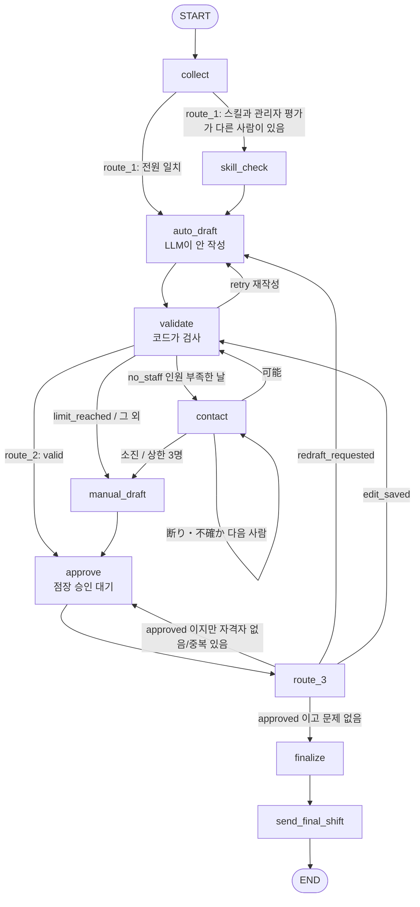

# CoverShift Backend (FastAPI)

# app/graph — 시프트 편성 그래프

[한국어](README.md) | [日本語](README.ja.md)

> **AI는 제안만 한다. 최종 확정은 사람(점장)이 한다.**
> 원본 설계는 `データフロー.md`이며, 어긋나면 그쪽이 기준이다.

LangGraph로 만든 월간 시프트 편성 그래프이다.
희망 수집 → AI(LLM)가 안 작성 → **코드가** 규칙 검사 → 점장이 승인하여 확정, 순서로 진행된다.
(규칙을 지켰는지 판단하는 것은 LLM이 아니라 코드이다.)

## 1. 파일 역할

| 파일              | 역할                                                                                    |
| ----------------- | --------------------------------------------------------------------------------------- |
| `shift_graph.py`  | **실행 입구만** 담당. `builder`를 외부에 노출한다. `python shift_graph.py start`로 실행 |
| `graph.py`        | **처리의 본체**. 노드(collect~send_final_shift)와 연결(`builder`)                       |
| `routes.py`       | 분기 `route_1`~`route_3` (다음에 어디로 갈지만 결정)                                    |
| `state.py`        | `State` (그래프 전체가 공유하는 상자)                                                   |
| `settings.py`     | 상수・점포별 설정・스태프 데이터. **B1/D5에서 DB・MCP 읽기로 교체할 곳**                |
| `node/checks.py`  | 규칙 검사와 계산. **LLM을 쓰지 않는, 코드만의 검사**                                    |
| `node/llm.py`     | LLM 준비와 답변에서 JSON 추출                                                           |
| `node/prompts.py` | LLM에 넘기는 문장(`rules`와 `make_*_text`)                                              |

import 방향(순환하지 않도록 한 방향): `settings` ← `state` / `node.checks` ← `routes` ← `graph` ← `shift_graph`

## 2. 처리 번호와 파일・함수 대응

설계서・주석에 있는 번호(`2-1` 등)로 코드 위치를 찾기 위한 표이다. **번호는 처리 흐름 순서**이다.

| 번호 | 내용                                      | 종류      | 파일               | 함수・대상                                    | 구 번호※       |
| ---- | ----------------------------------------- | --------- | ------------------ | --------------------------------------------- | -------------- |
| 0    | 초기 설정                                 | -         | `settings.py`      | 상수, `STORE_SETTINGS`, 스태프 데이터         | 0              |
| 1    | State 상자                                | -         | `state.py`         | `State`                                       | 1              |
| 2-1  | 희망・스킬・지시 읽기                     | 코드      | `graph.py`         | `collect`                                     | 2-1            |
| 2-2  | 스킬 체크 필요 여부                       | **분기①** | `routes.py`        | `route_1`                                     | 2-2            |
| 2-3  | 미확인 항목을 점장에게 알림(멈추지 않음)  | 코드      | `graph.py`         | `skill_check`                                 | 2-3            |
| 2-4  | AI가 편성안 작성                          | LLM       | `graph.py`         | `auto_draft`                                  | 2-5            |
| 2-5  | 각 규칙 검사                              | 코드      | `graph.py`         | `validate`                                    | 2-6            |
| 2-6  | 검사 결과에 따라 다음 경로 결정           | **분기②** | `routes.py`        | `route_2`                                     | 2-6c           |
| 2-7  | 관리자 수동 편성                          | 코드      | `graph.py`         | `manual_draft`                                | 2-7            |
| 2-8  | 인원이 부족한 날 연락(LINE 전송은 미구현) | 대기      | `graph.py`         | `contact`                                     | 2-8            |
| 2-9  | 관리자 승인                               | 대기      | `graph.py`         | `approve`                                     | 2-9            |
| 2-10 | 점장의 결정에 따라 다음 경로 결정         | **분기③** | `routes.py`        | `route_3`                                     | 2-10           |
| 2-11 | 확정 저장(임시 구현)                      | 코드      | `graph.py`         | `finalize`                                    | 2-11           |
| 2-12 | 각 직원에게 통지(임시 구현)               | 코드      | `graph.py`         | `send_final_shift`                            | 2-13           |
| 3-1  | 검사와 계산 도구                          | 코드      | `node/checks.py`   | `check_*`, `to_min`, `build_contact_queue` 등 | 2-4, 2-6, 2-6b |
| 3-2  | LLM 준비・JSON 추출                       | 코드      | `node/llm.py`      | `get_llm`, `extract_json`                     | 2-4            |
| 3-3  | LLM에 넘기는 문장                         | 코드      | `node/prompts.py`  | `rules`, `make_*_text`                        | 2-5, 2-6a      |
| 4    | 노드 등록                                 | -         | `graph.py`(아래쪽) | `builder.add_node`                            | 3              |
| 5    | 노드 연결                                 | -         | `graph.py`(아래쪽) | `builder.add_edge` 등                         | 4              |
| 6    | 실행                                      | -         | `shift_graph.py`   | `if __name__ == "__main__":`                  | 5              |

※ 구 번호는 이전 버전의 주석이나 `データフロー.md` 같은 예전 자료와 대조하기 위한 열이다. 예전의 「회사 규정으로 변환」(구 2-12)은 삭제했기 때문에 번호가 없다.

## 3. 흐름



## 4. 분기는 3개

| 분기               | 어디의 다음 | 보는 값                      | 행선지                                                                                                          |
| ------------------ | ----------- | ---------------------------- | --------------------------------------------------------------------------------------------------------------- |
| **route_1** (2-2)  | `collect`   | `staff_skill`과 `admin_rate` | 한 명이라도 다름 → `skill_check` / 전원 일치 → `auto_draft`                                                     |
| **route_2** (2-6)  | `validate`  | `result`                     | `valid` → `approve` / `no_staff` → `contact` / `retry` → `auto_draft` / `limit_reached`・그 외 → `manual_draft` |
| **route_3** (2-10) | `approve`   | `decision`                   | 아래 표                                                                                                         |

**route_3의 행선지**(점장의 결정별):

| decision            | 조건                                   | 행선지                                                                           |
| ------------------- | -------------------------------------- | -------------------------------------------------------------------------------- |
| `approved`          | 자격자 부재・중복이 **남아 있지 않음** | `finalize`                                                                       |
| `approved`          | 자격자 부재・중복이 **남아 있음**      | `approve`로 복귀(이유를 `blocked_reasons`에 담음)                                |
| `redraft_requested` | 재작성 요청 횟수가 2회 미만            | `auto_draft`(점장의 재작성 횟수 +1. LLM 호출 횟수와, 연락한 인원・후보를 초기화) |
| `redraft_requested` | 이미 2회 요청함                        | `approve`로 복귀(「2회까지입니다」라는 이유를 표시)                              |
| `edit_saved`        | (점장이 안을 고쳐서 저장함)            | `validate`(LLM은 호출하지 않음)                                                  |
| 그 외               | -                                      | `ValueError`                                                                     |

## 5. validate의 판정(result가 정해지는 방식)

`validate`는 위에서부터 차례로 확인하고, 가장 먼저 해당하는 항목으로 `result`가 정해진다.

| 순  | 조건                                                                                   | result          | 다음(route_2)                                                    |
| --- | -------------------------------------------------------------------------------------- | --------------- | ---------------------------------------------------------------- |
| ⓪   | 검사 횟수가 상한(`upper_limit`)을 넘음                                                 | `limit_reached` | `manual_draft`                                                   |
| ①   | 안이 비어 있음                                                                         | `retry`         | `auto_draft`                                                     |
| ②   | 문제가 있고, 점장이 고친 안(`edit_saved`)임                                            | `limit_reached` | `manual_draft`(LLM을 호출하지 않음. 점장의 편집이 사라지기 때문) |
| ③   | 문제가 있고, 이전과 같은 문제임(인원 숫자만 다른 경우도 같은 것으로 취급)              | `limit_reached` | `manual_draft`(더 이상 고칠 수 없음)                             |
| ④   | 문제가 있고, 재작성 상한(`UPPER_LIMIT` = 3)에 도달함                                   | `limit_reached` | `manual_draft`                                                   |
| ⑤   | 문제가 있음                                                                            | `retry`         | `auto_draft`(문제 목록을 다음 LLM에 전달)                        |
| ⑥   | 문제 없음                                                                              | `valid`         | `approve`                                                        |
| ⑥′  | 문제는 없으나, 인원이 부족한 날이 남아 있고 연락할 수 있는 사람이 있음(연락은 3명까지) | `no_staff`      | `contact`                                                        |

**검사는 7개**(`node/checks.py`. 모두 문제 문장의 리스트를 반환하며, 빈 리스트이면 문제 없음):

| 검사                   | 확인 내용                                                   | 승인을 막는가? |
| ---------------------- | ----------------------------------------------------------- | -------------- |
| `check_coverage`       | 모든 30분 구간에 사원이 1명 이상 있음(개점・폐점 작업 때문) | -              |
| `check_qualification`  | 자격자가 충분히 배치됨                                      | **막는다**     |
| `check_requests`       | 파트・아르바이트가 신청하지 않은 날에 들어가 있지 않음      | -              |
| `check_closing`        | 22:30까지 남는 사람은 `closing_ok`인 사람뿐                 | -              |
| `check_shain_days`     | 사원의 출근 일수가 규정대로임                               | -              |
| `check_headcount`      | 시간대별 최소 인원(애초에 부족한 날은 여기서 보지 않음)     | -              |
| `check_double_booking` | 같은 사람의 근무가 같은 날 겹치지 않음                      | **막는다**     |

「승인을 막는」 검사는 관리자도 해제할 수 없다. 남아 있으면 `approved`가 통과하지 못하고 `approve`로 돌아간다.

## 6. 멈추는 곳(interrupt)과 화면・API가 주고받는 값

그래프는 **2곳에서 멈추고**, 외부에서 `Command(resume=...)`로 재개한다. 재개하면 그 함수는 **처음부터 다시 실행**된다(그래서 LINE 전송은 `interrupt`보다 앞에 쓰면 안 된다).

### ① `approve`(점장 승인 대기)

멈출 때 화면에 내보내는 값:

| 키                  | 의미                                                |
| ------------------- | --------------------------------------------------- |
| `draft_store_shift` | 점포 전체의 월간 시프트 안                          |
| `ask`               | `"approved \| redraft_requested \| edit_saved"`     |
| `problems`          | 아직 고쳐지지 않은 문제 목록(참고용)                |
| `blocked_reasons`   | 승인할 수 없었던 이유(최대 20건. 읽으면 사라짐)     |
| `redraft_left`      | 앞으로 몇 번 더 재작성을 요청할 수 있는지(상한 2회) |

재개할 때 넘기는 값(문자열만으로도 가능):

```python
Command(resume="approved")
Command(resume={"decision": "redraft_requested", "instruction": "11/4 9시~13시를 4명 이상으로"})
Command(resume={"decision": "edit_saved", "assignments": [ {...}, ... ]})   # 점장이 고친 안
```

### ② `contact`(인원이 부족한 날, 한 명씩 연락)

- 멈출 때의 값: `{"ask": "可能 | 断り | 不確か", "staff_id", "staff_name", "date", "start", "end"}`
- 재개할 때의 값: `"可能"` / `"断り"` / `"不確か"` (`{"answer": "可能"}`도 가능. 그 외는 `ValueError`)
- 답변별 동작:
  | 답변 | 동작 |
  |---|---|
  | `可能`(가능) | 그 사람의 희망과 안에 해당 날짜의 근무를 추가 → `validate`로 복귀 |
  | `断り`(거절) / `不確か`(불확실) | 다음 사람에게(`不確か`는 이번에는 `断り`와 같게 취급). 상한 3명에 도달하거나 후보가 소진되면 `manual_draft` |

## 7. 숫자 규칙(상한)

| 항목                | 값                                             | 위치                    |
| ------------------- | ---------------------------------------------- | ----------------------- |
| 자동 편성(LLM) 횟수 | 한 번의 흐름에서 최대 3회(첫 1회 + 재작성 2회) | `UPPER_LIMIT`           |
| 점장의 「재작성」   | 2회까지                                        | `MANAGER_REQUEST_LIMIT` |
| 연락하는 인원       | 3명까지                                        | `contact_limit`         |
| `blocked_reasons`   | 화면에 최대 20건                               | `route_3`               |

점장이 「재작성」을 요청하면 LLM 호출 횟수는 0으로 돌아간다(점장의 재작성 횟수는 돌아가지 않는다).

## 8. State(그래프 전체가 공유하는 상자)

| 키                                                                  | 의미                                                                |
| ------------------------------------------------------------------- | ------------------------------------------------------------------- |
| `store_id`                                                          | 점포 ID                                                             |
| `period` | 대상 월 `{"start": "2026-11-01", "days": 30}`. 없으면 `settings.PERIOD`(B1에서 DB의 `shift_periods`로부터 넣음) |
| `llm_all_staff`                                                     | 전원의 데이터(이름은 삭제되어 있음)                                 |
| `draft_store_shift`                                                 | 점포 전체의 월간 시프트 안                                          |
| `result`                                                            | `validate`의 결과(`valid` / `retry` / `no_staff` / `limit_reached`) |
| `problems`                                                          | 검사에서 발견된 문제 목록(재작성 시 LLM에 되돌려줌)                 |
| `return_count` / `upper_limit`                                      | 자동 편성을 호출한 횟수 / 그 상한                                   |
| `decision` / `instruction`                                          | 점장의 결정 / 점장의 지시                                           |
| `manager_request_count`                                             | 점장이 「재작성」을 요청한 횟수                                     |
| `contact_queue` / `contact_asked` / `contact_limit` / `contact_log` | 연락 후보의 순서 / 연락한 인원 / 상한 / 연락 기록                   |
| `blocked_reasons`                                                   | 승인할 수 없는 이유(승인 화면에 표시)                               |
| `final_message`                                                     | 최종 시프트 전송 메시지                                             |

## 9. 실행・확인 방법

```powershell
# 실제에 가까운 실행 (PostgreSQL이 localhost:5433에서 실행 중이고, .env에 DATABASE_URL과 유효한 ANTHROPIC_API_KEY가 필요)
cd app\graph
python shift_graph.py start                 # 처음부터. 승인 대기에서 멈춤
python shift_graph.py approve               # 승인으로 재개
python shift_graph.py contact 可能          # 연락 답변으로 재개
python shift_graph.py redraft               # 재작성 요청으로 재개

# 테스트 (가짜 LLM을 쓰므로 DB도 API 키도 필요 없음)
cd test\graph
python test_step1.py                        # 검사・승인・재작성   T1~T7
python test_contact.py                      # 연락 흐름           A~E
# 둘 다 마지막에 ALL PASS가 나오면 정상
```

테스트는 `node.llm.LLM`에 가짜 LLM을 넣어 실행한다. **실제 LLM은 1회에 약 6~10분이 걸린다.**

## 10. 현재 미완성인 부분(솔직하게)

- `collect`는 DB가 아니라 `settings.py`가 읽은 `staff_data.json`을 넘긴다(B1에서 DB 읽기로 교체). MCP 호출은 주석 처리 상태(D5).
- 점포는 `STORE_SETTINGS`의 101번, 기간은 `PERIOD`(2026-11, 30일)로 고정(테스트용 데이터). 검사・프롬프트는 월의 일수(28~31일)와 요일별 규칙(규칙의 `weekdays`: 1=월~7=일. 없으면 매일)에 대응 완료. `State`의 `period`를 넘기면 그 달 기준으로 동작한다(B1에서 DB로부터 넣음).
- `settings.py`는 `staff_data.json`을 **현재 폴더에서** 찾는다. `app\graph` 안에서 실행하지 않으면 `FileNotFoundError`가 발생한다(B1에서 해소 예정).
- `finalize`(확정 저장)와 `send_final_shift`(LINE 통지)는 메시지만 돌려주는 임시 구현이다(B8/B9).
- `contact`는 LINE 전송이 없고, 답변을 받는 부분만 있다.
- `route_1` / `skill_check`는 `staff_skill`과 `admin_rate` 두 열이 있다는 전제이다. DB에 이 열이 있는지는 미확인.
- 연락 후보의 순서는 「최근 근무 일수가 적은 사람이 먼저」뿐이다(스킬 일치는 미구현).
